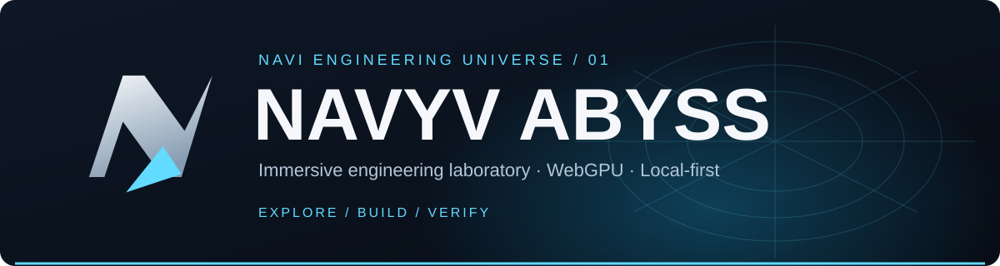

<p align="center"></p>
<p align="center"><strong>Immersive engineering laboratory · NAVI-OS reference 01</strong></p>
<p align="center"><a href="reference.html">NAVI reference interface</a> · <a href="index.html">WebGPU experience</a> · <a href="docs/ENGINEERING.md">Engineering</a> · <a href="https://github.com/Neguchads/navi-core">Core / NEF</a> · <a href="https://github.com/Neguchads/navi-graphify">Graphify</a></p>

NAVYV Abyss is a local-first presentation laboratory for the [NAVI Engineering Universe](https://github.com/Neguchads/Neguchads). The dedicated reference dashboard exposes project architecture and verification boundaries; the separate WebGPU experience explores a procedural underwater world. No account, AI provider, telemetry or external asset dependency is needed.

## NAVI reference interface


| Architecture | Engineering |
|---|---|
|  |  |

These screenshots are captured from the repository's own `reference.html` using Chromium. They depict the local interface, not GPU runtime evidence or live NAVI telemetry. See [capture provenance](docs/CAPTURES.md).

## Explore locally

- **Reference dashboard:** download [reference.html](reference.html) and open it in a browser; it works without WebGPU. Use the Overview, Architecture and Engineering tabs. Keep the repository files together for local navigation and documentation links.
- **Immersive scene:** download [index.html](index.html), open it in Chrome or Edge with WebGPU enabled, then enter the scene. It contains its own rendering and audio code.

| Controls | Input |
|---|---|
| Swim and look | WASD and mouse |
| Depth and speed | Q / E, Shift |
| Viewpoints | 1–6 |
| Menu and resume | Esc |
| Audio and statistics | M / H |
| Quality presets | Low / Medium / High |

Touch support is experimental. The scene requires a supported WebGPU adapter; the reference dashboard does not. The project does not claim newly measured GPU performance.

## Engineering

| Layer | Reference |
|---|---|
| Local presentation | [reference.html](reference.html) |
| Immersive runtime | [source/src](source/src) |
| Deterministic composition | [source/reference.mjs](source/reference.mjs) |
| NAVI Core | [.navi/project.toml](.navi/project.toml) · [pilot](.github/workflows/navi-pilot.yml) |
| NEF | [Architecture / roadmap / handoff](docs/ENGINEERING.md) |
| Public ecosystem | [integration](integration/README.md) |
| Visual evidence | [capture script](scripts/capture-reference.sh) |

```sh
cd source
npm ci
npm run verify
npm run build
npm run verify
```

Use `npm run build:readable` for debugging or `npm run build:dev` for the development fly-through and benchmark. Static checks and browser screenshots do not certify the WebGPU runtime.

## License & credits

[MIT](LICENSE). Original procedural underwater engine: [Abyssal Garden](https://github.com/Noniv/abyssal-garden), copyright 2026 Maksymilian Dendura. NAVYV dashboard, reference shell, documentation and engineering integration: Neguchads. Original license and copyright are retained. Git history preserves upstream provenance.
