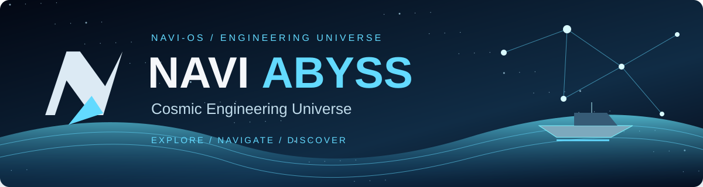
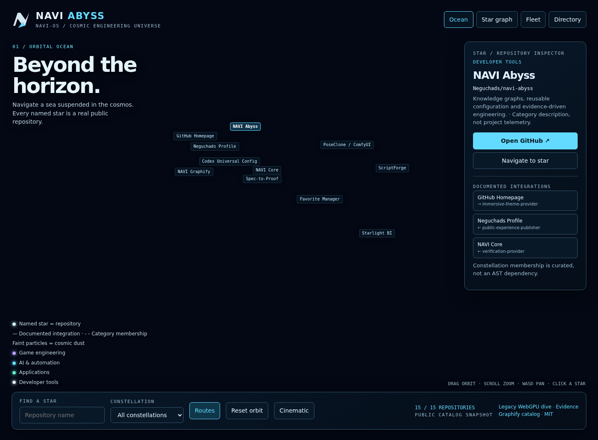
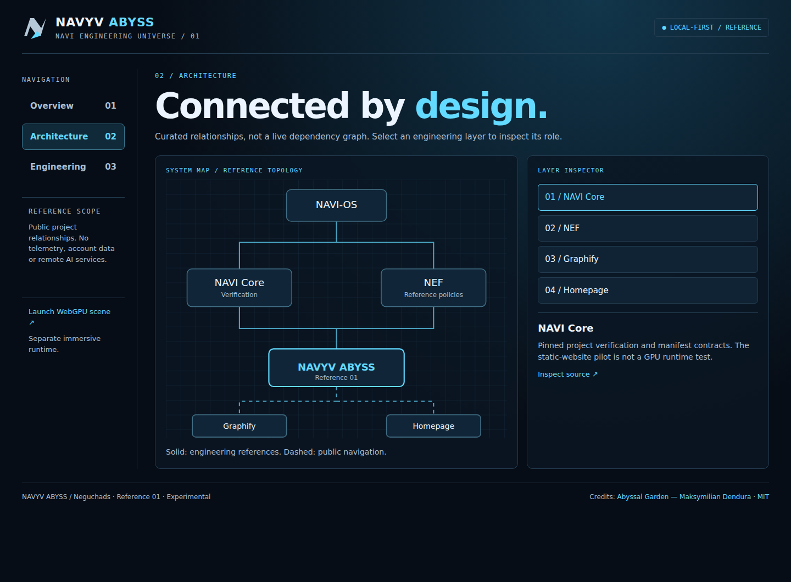
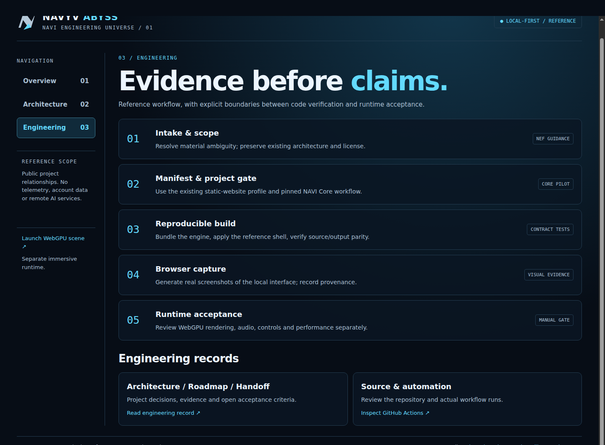

<p align="center"></p>

<p align="center"><strong>A cosmic ocean where repositories become stars and engineering becomes exploration.</strong></p>
<p align="center"><a href="reference.html">Launch the 3D universe</a> · <a href="docs/ENGINEERING.md">Architecture / roadmap / handoff</a> · <a href="https://github.com/Neguchads/navi-graphify">Graphify</a> · <a href="https://github.com/Neguchads/navi-core">NAVI Core / NEF</a></p>

## Cosmic Engineering Universe

Explore a suspended procedural ocean in deep space, flying naval vessels and constellations of actual public repositories. Every named star is a public GitHub repository; select it to inspect documented integrations and open the repository. Faint particles are cosmic dust. The graph uses the reviewed public catalog, not private graphs or invented dependencies.



| Stellar graph | Naval exploration |
|---|---|
|  |  |

## Explore

Download [reference.html](reference.html) and open locally in a modern browser. The single file embeds a public Graphify snapshot and procedural perspective 3D renderer (Canvas software projection; not WebGPU). No external assets, network calls, AI or account needed for exploration. Repository links open GitHub.

| Interaction | Input |
|---|---|
| Orbit / zoom | Drag / wheel |
| Pan | W A S D when canvas/page has focus |
| Inspect or travel | Click star or label; Navigate to star |
| Discover | Search, constellation filter, Directory |
| Ocean / Star graph / Fleet | Mode buttons |
| Clean view | Cinematic; Esc or Exit cinematic |

15 verified-public catalog repositories in the initial snapshot, not an exhaustive account inventory. Solid lines indicate catalog integrations; dashed lines indicate curated category membership. [Catalog provenance](cosmic/catalog.json). No live telemetry or AST dependency inference.

## Engineering

```sh
cd source
npm ci
npm run build
npm run verify
```

`reference.html` is built from `cosmic/` by the same build command. The older [index.html](index.html) remains a separate WebGPU underwater experience, preserving the upstream runtime and license. [Capture script](scripts/capture-reference.sh) generates real 1440 × 1060 browser screenshots; [evidence](docs/CAPTURES.md). The current prototype uses a CPU-side perspective 3D mesh renderer; GPU shaders and free-flight controls are roadmap items.

## License & credits

[MIT](LICENSE). Legacy underwater engine derived from [Abyssal Garden](https://github.com/Noniv/abyssal-garden), copyright 2026 Maksymilian Dendura. NAVI cosmic scene, integration and reference interface: Neguchads. Original attribution is retained.

[Open-source credits, provenance and distribution review](CREDITS.md).
